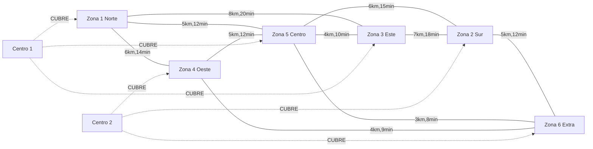

# Modelo de grafo — Red de conexiones (Neo4j)

Documenta el modelo de grafo del **RF-6 / Issue #6**: zonas, vías, distancias y
tiempos como grafo, no como tablas relacionales.

## Visión general

La red de reparto (zonas, conexiones entre ellas, distancias y tiempos) se modela
en Neo4j para consultar caminos óptimos y rutas alternativas. El núcleo relacional
(Pedidos, Centros, Repartidores, etc.) vive en PostgreSQL/Prisma; aquí solo la red.

Los `id` de `Zona` y `Centro` están **alineados con los `id` de Prisma** para poder
correlacionar ambos motores.

## Nodos

| Nodo | Propiedades | Descripción |
| :--- | :--- | :--- |
| `Zona` | `id` (int, único), `nombre` (string) | Zona de reparto |
| `Centro` | `id` (int, único), `nombre` (string), `programaLogistico` (string) | Centro de distribución |

## Relaciones

| Relación | Entre | Propiedades | Descripción |
| :--- | :--- | :--- | :--- |
| `CONECTA` | `Zona` → `Zona` | `distanciaKm` (float), `tiempoMin` (int), `tipoVia` (string) | Vía entre dos zonas. **Sin dirección** (se recorre en ambos sentidos) |
| `CUBRE` | `Centro` → `Zona` | — | Zonas que cubre un centro |



## Restricciones e índices

Definidas en `Backend/neo4j/schema.cypher`:

```cypher
CREATE CONSTRAINT zona_id IF NOT EXISTS FOR (z:Zona) REQUIRE z.id IS UNIQUE;
CREATE CONSTRAINT centro_id IF NOT EXISTS FOR (c:Centro) REQUIRE c.id IS UNIQUE;
CREATE INDEX zona_nombre IF NOT EXISTS FOR (z:Zona) ON (z.nombre);
CREATE INDEX centro_nombre IF NOT EXISTS FOR (c:Centro) ON (c.nombre);
```

## Carga inicial (seed)

- `Backend/neo4j/seed.cypher` — zonas, centros, conexiones y cobertura de ejemplo.
- `Backend/neo4j/seed.mjs` — runner que aplica `schema.cypher` + `seed.cypher`
  usando `neo4j-driver` y las credenciales de `Backend/.env`.
- Comando: `npm run seed:neo4j` (desde `Backend/`).

## Integración con NestJS

- `Backend/src/neo4j/neo4j.service.ts` — driver oficial `neo4j-driver`; valida la
  conexión al iniciar (`verifyConnectivity`) y expone `read()` / `write()`.
- `Backend/src/neo4j/neo4j.module.ts` — módulo `@Global` que provee `Neo4jService`.

Variables de entorno (`Backend/.env`):

| Variable | Ejemplo | Uso |
| :--- | :--- | :--- |
| `NEO4J_URI` | `bolt://localhost:7687` | Endpoint Bolt |
| `NEO4J_USER` | `neo4j` | Usuario |
| `NEO4J_PASSWORD` | `password` | Contraseña (debe coincidir con `NEO4J_AUTH` del compose) |
| `NEO4J_DATABASE` | `neo4j` | Base de datos |

## Endpoints

| Método | Ruta | Query | Respuesta |
| :--- | :--- | :--- | :--- |
| `GET` | `/grafo/zonas/:origenId/camino-mas-corto` | `destinoId` (req), `criterio` (`distancia`\|`tiempo`, def. `distancia`) | `{ zonas, costo, saltos }` |
| `GET` | `/grafo/zonas/:origenId/rutas-alternativas` | `destinoId` (req), `criterio` (def. `distancia`), `limite` (def. `3`, máx. `10`) | `[{ zonas, costo, saltos }]` |

Ejemplos:

```bash
curl "http://localhost:3000/grafo/zonas/1/camino-mas-corto?destinoId=2&criterio=distancia"
# { "zonas": [1,5,2], "costo": 11, "saltos": 2 }

curl "http://localhost:3000/grafo/zonas/1/camino-mas-corto?destinoId=2&criterio=tiempo"
# { "zonas": [1,5,2], "costo": 27, "saltos": 2 }

curl "http://localhost:3000/grafo/zonas/1/rutas-alternativas?destinoId=2&limite=3"
# [ { "zonas":[1,5,2], "costo":11, "saltos":2 },
#   { "zonas":[1,5,6,2], "costo":13, "saltos":3 },
#   { "zonas":[1,4,6,2], "costo":15, "saltos":3 } ]
```

## Consultas Cypher

Camino más corto ponderado (APOC):

```cypher
MATCH (a:Zona {id: $origen}), (b:Zona {id: $destino})
CALL apoc.algo.dijkstra(a, b, 'CONECTA', 'distanciaKm')
YIELD path, weight
RETURN [n IN nodes(path) | n.id] AS zonas, weight AS costo, length(path) AS saltos;
```

Rutas alternativas (APOC):

```cypher
MATCH (a:Zona {id: $origen}), (b:Zona {id: $destino})
CALL apoc.algo.allSimplePaths(a, b, 'CONECTA', 6)
YIELD path
WITH path, reduce(total = 0.0, r IN relationships(path) | total + toFloat(r['distanciaKm'])) AS costo
RETURN [n IN nodes(path) | n.id] AS zonas, costo, length(path) AS saltos
ORDER BY costo ASC LIMIT 3;
```

## Levantar Neo4j y verificar

```bash
docker compose up -d neo4j
docker exec rutas-neo4j cypher-shell -u neo4j -p password "RETURN apoc.version()"
docker exec rutas-neo4j cypher-shell -u neo4j -p password "MATCH (n) RETURN labels(n) AS tipo, count(*) AS total"
```

> Requiere el plugin APOC (`NEO4J_PLUGINS: '["apoc"]'` en `docker-compose.yml`).

## Referencias

- Issue #6 — RF-6 (red de conexiones en Neo4j).
- `Backend/neo4j/schema.cypher`, `Backend/neo4j/seed.cypher`.
- `Backend/src/neo4j/`, `Backend/src/grafo/`.