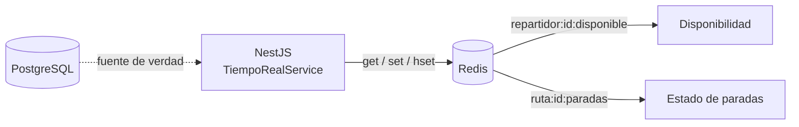

# Modelo de datos en tiempo real — Redis

Documenta el uso de Redis del **RF-5 / Issue #33**: disponibilidad de
repartidores y estado de las paradas de una ruta, datos que cambian durante la
jornada y que no conviene consultar contra PostgreSQL en cada petición.

Redis es **caché / estado efímero**, no la fuente de verdad. La fuente de verdad
sigue siendo PostgreSQL (Prisma); si una clave no existe, el dato se reconstruye.

## Visión general



## Infraestructura

Definida en `docker-compose.yml`:

```yaml
redis:
  image: redis:7-alpine
  container_name: rutas-redis
  ports:
    - "6379:6379"
  command: ["redis-server", "--appendonly", "yes"]
  volumes:
    - redis_data:/data
  restart: unless-stopped
```

| Elemento | Valor |
| :--- | :--- |
| Imagen | `redis:7-alpine` |
| Contenedor | `rutas-redis` |
| Puerto | `6379` |
| Persistencia | `--appendonly yes` (AOF) sobre el volumen `redis_data` |
| Reinicio | `unless-stopped` |

```bash
docker compose up -d redis
docker exec rutas-redis redis-cli PING   # PONG
```

> La persistencia AOF evita perder las claves al reiniciar el contenedor, pero
> los TTL siguen aplicándose: el estado de paradas caduca a las 24 h.

## Variables de entorno

En `Backend/.env` (y documentada en `Backend/.env.example`):

| Variable | Ejemplo | Uso |
| :--- | :--- | :--- |
| `REDIS_URL` | `redis://localhost:6379` | Cadena de conexión de `ioredis` |

`RedisModule` la lee con `ConfigService.getOrThrow('REDIS_URL')`, así que la
aplicación **no arranca** si falta. No se commitea ningún `.env`.

## Claves

Nombre: `recurso:{id}:atributo`, en minúsculas y sin espacios.

| Clave | Tipo | Contenido | TTL |
| :--- | :--- | :--- | :--- |
| `repartidor:{id}:disponible` | `string` | `"1"` disponible, `"0"` no disponible | Sin TTL |
| `ruta:{id}:paradas` | `hash` | campo `idParada` → estado (`Pendiente`, `Visitada`, `Fallida`) | 24 h desde la última escritura |

Notas:

- `repartidor:{id}:disponible` no caduca: es un flag que se sobrescribe cuando el
  repartidor cambia de estado. Su ausencia se interpreta como **no disponible**
  (`obtenerDisponibilidad` devuelve `false`).
- `ruta:{id}:paradas` es un hash porque se actualiza una parada a la vez sin
  reescribir el resto. Cada `HSET` renueva el TTL a 24 h
  (`TTL_PARADAS_SEGUNDOS = 24 * 60 * 60`).
- `idRuta` e `idParada` son los ids de Prisma; no se guardan datos personales ni
  credenciales en Redis.

Estados admitidos (`ESTADOS_PARADA` en `tiempo-real.service.ts`):

```ts
['Pendiente', 'Visitada', 'Fallida']
```

`RedisService` también expone un par genérico para JSON:
`getJson<T>(clave)` / `setJson<T>(clave, valor, ttlSegundos?)`, que serializa con
`JSON.stringify` y, si se indica TTL, usa `SET clave valor EX segundos`.

## Integración con NestJS

| Archivo | Responsabilidad |
| :--- | :--- |
| `Backend/src/redis/redis.constants.ts` | Token `REDIS_CONFIG` y tipo `RedisConfig` |
| `Backend/src/redis/redis.module.ts` | Módulo `@Global`; provee `REDIS_CONFIG` y `RedisService` |
| `Backend/src/redis/redis.service.ts` | Envoltorio de `ioredis`: `get`, `set`, `del`, `mget`, `hset`, `hgetall`, `expire`, `getJson`, `setJson` |
| `Backend/src/tiempo-real/tiempo-real.service.ts` | Lógica de negocio de disponibilidad y paradas |
| `Backend/src/tiempo-real/tiempo-real.module.ts` | Provee `TiempoRealService` (sin controlador HTTP todavía) |

Conexión (`redis.service.ts`):

```ts
this.client = new Redis(config.url, {
  maxRetriesPerRequest: 2,
  enableOfflineQueue: false,
});
```

- `onModuleInit()` hace `PING` y registra `Conectado a Redis (...)`.
- `onModuleDestroy()` cierra con `QUIT` salvo que el estado ya sea `end`.
- `enableOfflineQueue: false` hace fallar rápido si Redis no está disponible, en
  lugar de acumular comandos.

> `ioredis@6` es CommonJS. Con `"module": "nodenext"` hay que usar el named
> import `import { Redis } from 'ioredis'`; el import por defecto no es
> construible para TypeScript (`TS2709` / `TS2351`).

### Métodos de `TiempoRealService`

| Método | Clave | Operación |
| :--- | :--- | :--- |
| `marcarDisponibilidad(idRepartidor, boolean)` | `repartidor:{id}:disponible` | `SET` `"1"`/`"0"` |
| `obtenerDisponibilidad(idRepartidor)` | `repartidor:{id}:disponible` | `GET`; `true` solo si es `"1"` |
| `listarDisponibles(ids[])` | varias | `MGET` y filtro de los que valen `"1"` |
| `actualizarEstadoParada(idRuta, idParada, estado)` | `ruta:{id}:paradas` | `HSET` + `EXPIRE` 24 h |
| `obtenerEstadoParadas(idRuta)` | `ruta:{id}:paradas` | `HGETALL` |

## Seed

`Backend/redis/seed.mjs` carga datos de ejemplo para desarrollo y pruebas.

| Clave | Valor |
| :--- | :--- |
| `repartidor:1:disponible` | `1` |
| `repartidor:2:disponible` | `0` |
| `repartidor:3:disponible` | `1` |
| `ruta:1:paradas` | `1 → Visitada`, `2 → Pendiente`, `3 → Pendiente` (TTL 24 h) |

Comandos (desde `Backend/`):

```bash
npm run seed:redis   # solo Redis
npm run seed         # Neo4j + Redis
```

El script:

- Lee `REDIS_URL` desde `Backend/.env` con `dotenv`.
- Es **idempotente**: `SET` sobrescribe la disponibilidad y `DEL` + `HSET`
  regeneran el hash de paradas con TTL nuevo.
- Cierra la conexión con `QUIT` incluso si hay error (`finally`), y marca
  `process.exitCode = 1` en caso de fallo.

```bash
npm run seed:redis
# Seed de Redis completado (3 repartidores, 3 paradas).
```

## Verificación

```bash
docker exec rutas-redis redis-cli GET repartidor:1:disponible   # "1"
docker exec rutas-redis redis-cli GET repartidor:2:disponible   # "0"
docker exec rutas-redis redis-cli GET repartidor:3:disponible   # "1"

docker exec rutas-redis redis-cli HGETALL ruta:1:paradas
# 1
# Visitada
# 2
# Pendiente
# 3
# Pendiente

docker exec rutas-redis redis-cli TTL ruta:1:paradas             # ~86400
docker exec rutas-redis redis-cli EXISTS repartidor:9:disponible # 0 (no existe)
```

Listar las claves del proyecto:

```bash
docker exec rutas-redis redis-cli --scan --pattern 'repartidor:*'
docker exec rutas-redis redis-cli --scan --pattern 'ruta:*'
```

## Notas

- Al arrancar, NestJS registra `RedisService Conectado a Redis (...)`. Si Redis
  no está levantado, el arranque falla en `PING` (fallo rápido y explícito).
- `TiempoRealService` todavía no expone endpoints HTTP; está listo para que los
  consuman otros servicios o un futuro controlador/WebSocket.
- Al usar `docker compose down` sin `-v`, el volumen `redis_data` se conserva.

## Referencias

- Issue #33 — RF-5 (navegación de la red de zonas, rutas alternativas y Redis).
- `Backend/src/redis/`, `Backend/src/tiempo-real/`, `Backend/redis/seed.mjs`.
- `docker-compose.yml`, `Backend/.env.example`.
- [`neo4j-modelo.md`](./neo4j-modelo.md) — red de zonas y rutas.
